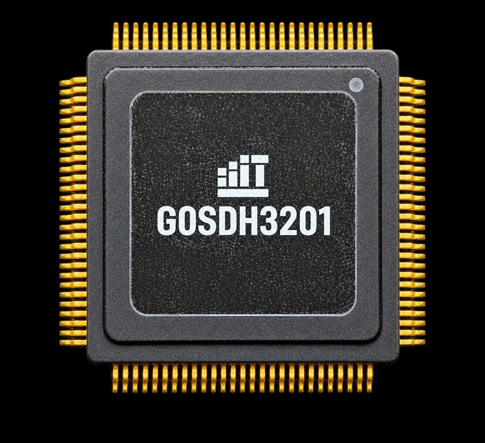
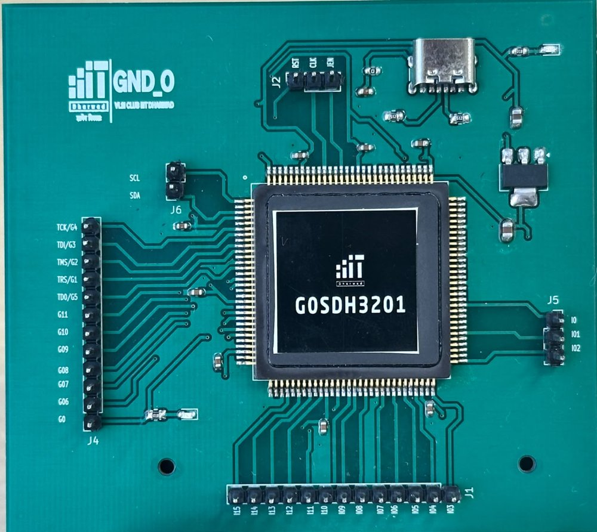
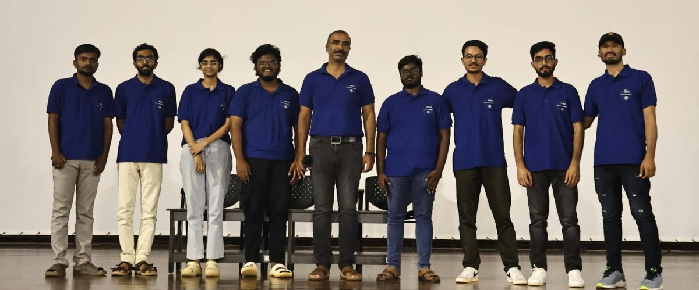
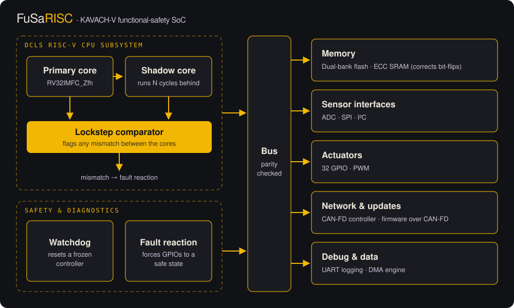

# GND_0 · VLSI Club, IIIT Dharwad

**From logic gates to layouts: learn, build and tape out together.**

A student community at IIIT Dharwad for VLSI design and semiconductors.
**Two chips so far:** SIDHARUD1 is back from the fab and validated, and FuSaRISC is in design now.

---

## 👋 New here? Start in 3 steps

1. **Say hello.** Introduce yourself in [Discussions → Introductions](https://github.com/orgs/GND-0/discussions).
2. **Pick your path.** Follow the [Learning Roadmap](https://github.com/GND-0/.github/blob/main/learning/ROADMAP.md), from your first Verilog module to your first chip.
3. **Make your first contribution.** Grab a [`good first issue`](https://github.com/issues?q=org%3AGND-0+is%3Aopen+label%3A%22good+first+issue%22) and open a pull request.

> Read the [Community Rules](https://github.com/GND-0/.github/blob/main/COMMUNITY_RULES.md) before you post. They are short.

## 🔬 Our silicon

| | Chip | Process | Status |
|---|---|---|---|
| 01 | [**SIDHARUD1**](#-tape-out-01--sidharud1-g0sdh3201): RISC-V microcontroller / smart GPIO expander | GlobalFoundries GF180MCU, 180 nm | ✅ Silicon received and validated |
| 02 | [**FuSaRISC**](#-tape-out-02--fusarisc-kavach-v): functional-safety SoC for vehicles | 28 nm | 🛠️ In progress |

### 🥇 Tape-out 01 · SIDHARUD1 (G0SDH3201)

<table>
<tr>
<td width="50%"></td>
<td width="50%"></td>
</tr>
<tr>
<td align="center">The packaged chip: G0SDH3201, CQFP120</td>
<td align="center">Our evaluation board: USB-C, JTAG/GPIO, I²C and input headers</td>
</tr>
</table>

 
The SIDHARUD1 team

**Our first chip, designed by students and fabricated by GlobalFoundries.** SIDHARUD1 is a 32-bit RISC-V microcontroller that works as a software-programmable GPIO expander. A host loads firmware over two I²C wires and the chip runs it locally, with no external flash. It reads switches and sensors, decides, and drives pumps, lights, fans or alarms. Several chips can be chained when a design needs more I/O.

It is named after **Siddharoodha Swami of Hubballi**. The part number reads **G0**·**SDH**·**32**·**01**: GND_0, the Sidharud family, 32-bit RISC-V, revision 1.

| Spec | Value |
|---|---|
| CPU | OpenHW **CV32E40P** RISC-V core (RV32IM + CSR), based on the CORE-V MCU with the eFPGA removed |
| Process | GlobalFoundries **GF180MCU 180 nm**, 5 V standard cells |
| Die | 2935 × 2935 µm (3.144 mm² cell area after synthesis) |
| Clocks | 20 MHz system · 50 MHz JTAG |
| Memory | 1 KB SRAM · Boot ROM with an I²C bootloader (17 commands) |
| I/O | 16 GPIO inputs · 12 GPIO outputs · I²C slave (100 kHz – 1 MHz) · JTAG debug (pins shared with GPIO) |
| Package | CQFP120 · 88-pad ring, 55 bonded |
| Design flow | Synopsys Design Compiler → IC Compiler II, then DRC/LVS, extraction and post-layout timing |
| Programme | **Synopsys + GlobalFoundries university MPW shuttle.** IIIT Dharwad was one of 6 institutes in India and 55 worldwide selected. |

**Journey:** idea and team formed in **May 2025** → RTL, synthesis and physical design through **September 2025** → final layout `SIDHARUD1_rev13.gds` declared tape-out ready in **October 2025** → fabricated by GlobalFoundries in Germany → **silicon received and validated** on our own evaluation board → showcased at the **Bengaluru Tech Summit**.

**Where it fits:** drip irrigation and greenhouse control, cold-storage alarms, small-factory automation, low-cost health monitors, streetlights and water pumps, and classroom robotics.

**Team:** led by student lead **Shivashankar B** with third- and fourth-year members of GND_0 · **Faculty guide:** Asst. Prof. Jagadish DN · **Industry mentors:** Anand J Bariya, Santosh Devanalikkar

### 🛡️ Tape-out 02 · FuSaRISC (KAVACH-V)

**KAVACH-V: Kernel for Automotive Vigilance, Armored Control Hardware.** FuSaRISC is a RISC-V system-on-chip meant to be the high-reliability brain of software-defined vehicles. It moves safety checks out of software and into the silicon, and is being designed toward **ISO 26262 ASIL-D** practices. It is our second tape-out, at **28 nm**, sponsored by the **VLSI Society of India**.

| Feature | What it does |
|---|---|
| **Dual-core lockstep (DCLS)** | A shadow RV32IMFC_Zfh core repeats every instruction a few cycles later; a comparator flags any mismatch |
| **ECC SRAM** | Detects and corrects bit-flips caused by heat, vibration or interference |
| **Watchdog + fault reaction** | Resets a frozen controller and forces outputs to a safe state, in hardware |
| **Parity-checked bus** | Catches corrupted transfers between blocks |
| **I/O** | 32 GPIO, PWM, ADC, SPI, I²C, UART logging, DMA |
| **Dual-bank flash + CAN-FD** | Firmware updates over the vehicle network, with a fallback bank |

**Early performance (RTL simulation):** the RV32IM core configuration scores **2.626 CoreMark/MHz** with zero-wait-state memory. That is 276.9 M retired instructions for 1,000 iterations at an average CPI of 1.375. The CRCs match the official values, and the instruction count matches the Spike reference simulator exactly.

> 🙋 **Want to work on silicon like this?** Start with the [Learning Roadmap](https://github.com/GND-0/.github/blob/main/learning/ROADMAP.md), then join a project through [Discussions](https://github.com/orgs/GND-0/discussions).

## 🏆 Highlights

- **2 chip tape-outs** by students: 180 nm (SIDHARUD1) and 28 nm (FuSaRISC)
- **10+ events:** *Hack Maze 2025* (48-hour hackathon), *Hack Maze 2.0* (2026) with participants from across India, an RTL-to-GDS workshop, and VLSI test and DFT training
- **Industry EDA tools** from Synopsys, Cadence, Siemens and Keysight, accessed through ChipIN at C-DAC under the **DLI scheme**
- Guest talks and alumni sessions bridging academia and industry

## 🧭 What we do

| | |
|---|---|
| 📚 **Learn** | Study circles, hands-on labs and a structured roadmap: digital design, Verilog/SystemVerilog, verification, FPGA, RTL-to-GDS, analog layout |
| 🛠️ **Build** | Open-source RTL projects, verification IPs, FPGA demos and tools, all reviewed through pull requests |
| 🔬 **Tape out** | Group submissions to open-silicon shuttles (e.g. [Tiny Tapeout](https://tinytapeout.com)) with open PDKs such as SKY130, GF180MCU and IHP SG13G2 |
| 🎤 **Share** | Workshops, talks, hackathons and the *VLSI Pulse* digest on our website |
| 🤝 **Connect** | Alumni and industry mentors, interview prep and internship leads |

## 📦 Repositories

| Repository | What it is | Good for |
|---|---|---|
| [`VLSI_WEB`](https://github.com/GND-0/VLSI_WEB) | Club website (Next.js + Sanity + Firebase) | Web devs, designers |
| [`VLSI-CLUB-SANITY`](https://github.com/GND-0/VLSI-CLUB-SANITY) | Content studio behind the website | Content and schema editors |
| [`rtl-project-template`](https://github.com/GND-0/rtl-project-template) | Starter for every new hardware project, with simulation, lint and synthesis CI built in | Anyone starting a project |
| [`.github`](https://github.com/GND-0/.github) | Rules, governance, templates and the learning roadmap | Everyone |

*Projects are tagged by domain: look for the topics `rtl`, `verification`, `fpga`, `physical-design`, `analog`, `tooling`, `learning`.*

## 🧑‍🤝‍🧑 How the community works

- **Anyone can learn and contribute.** You don't have to be a member to open an issue or a pull request.
- **IIIT Dharwad students can join the org** through the [membership process](https://github.com/GND-0/.github/blob/main/MEMBERSHIP.md).
- **Contributors grow into maintainers** by reviewing, mentoring and owning a project ([Governance](https://github.com/GND-0/.github/blob/main/GOVERNANCE.md)).
- **Everything happens in the open:** proposals, decisions and project plans live in Discussions and Issues.

| 📜 Policies | |
|---|---|
| [Code of Conduct](https://github.com/GND-0/.github/blob/main/CODE_OF_CONDUCT.md) | How we treat each other |
| [Community Rules](https://github.com/GND-0/.github/blob/main/COMMUNITY_RULES.md) | The dos and don'ts, including PDK/NDA and academic-integrity rules |
| [Contributing Guide](https://github.com/GND-0/.github/blob/main/CONTRIBUTING.md) | Branches, commits, pull requests, reviews |
| [Governance](https://github.com/GND-0/.github/blob/main/GOVERNANCE.md) | Roles, teams, decisions, elections |
| [Membership](https://github.com/GND-0/.github/blob/main/MEMBERSHIP.md) | How to join and level up |
| [Repository Standards](https://github.com/GND-0/.github/blob/main/docs/REPO_STANDARDS.md) | Naming, required files, licensing |
| [Security Policy](https://github.com/GND-0/.github/blob/main/SECURITY.md) | Reporting vulnerabilities and leaked secrets |

## 📬 Contact

- **General:** [GitHub Discussions](https://github.com/orgs/GND-0/discussions)
- **Email:** gnd0vlsi@iiitdwd.ac.in
- **Conduct concerns:** see the [Code of Conduct](https://github.com/GND-0/.github/blob/main/CODE_OF_CONDUCT.md#reporting)

GND_0: every circuit needs a ground reference. We aim to be that for VLSI at IIIT Dharwad. ⏚

